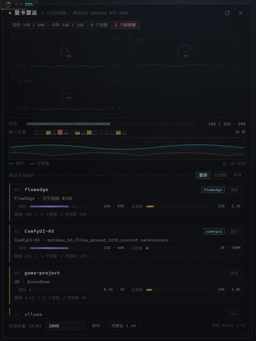

# 显卡雷达 GPU Radar

一个 DSH 插件。输入框左侧有个小徽标，显示显卡、显存、处理器的当前读数。点开是浮层，显存占用按项目归组，
点进项目可以看到它起了哪些进程、在跑什么任务、挂着哪些模型，可以对进程做暂停、恢复、结束，也能给项目设显存预算。



## 功能

- 三块圆表：显卡利用率、显存占用、处理器利用率，每块底下带一条 0–100% 的迷你走势
- 内存占用条，每个核心一根负载柱
- 项目排行按显存降序，每行两条进度（显存、处理器），可切换按处理器或内存排序
- 项目详情：成员进程、显存、处理器、内存、峰值；运行概况；在用的模型；正在跑的任务
- 进程管控：暂停、恢复、结束，单个进程或整个项目
- 显存预算：给项目设上限，超额标红；保留余量可以一键采用建议值
- 跟随主题，深浅两套配色

## 界面

```
● 显卡雷达     1 个任务在跑 · NVIDIA GeForce RTX 4090          ⟳ ×
[显存 17G / 24G] [内存 16G / 32G] [8 个进程] [1 个超预算]
┌ 显卡          利用率 ┐ ┌ 显存          占用 ┐
│      38%            │ │      71%            │
│ 48°C ~~~‾~~~ 196W   │ │ 24G ~~~‾~~ 可分配   │
└─────────────────────┘ └─────────────────────┘
┌ 处理器        利用率 ┐
│      23%            │
│ 32线程 ~~~ 16 核     │
└─────────────────────┘
内存      ──────────────────────────────  16G / 32G · 50%
核心负载  ▮▮▮▯▮▮▯▮ ...                    16 核
╱‾‾‾╲___╱‾‾╲_ 示波器（显存实线 / 处理器虚线，近 10 分钟）
───────────────────────────────────────────────────────
项目占用排行                          [显存][处理器][内存]
01 flowedge  [flowedge] [桌面]
   显存 ▮▮▮▮▮▮▮▮▮▮░░  16G·65%   处理器 ▮▮▮░░░░  12%·2.3G
   峰值 19G / 3 个进程 / 利用率 38%                    ›
02 ComfyUI-H3 ...
```

点一行进入详情，Esc 逐级返回：

```
‹ 返回  flowedge                                     [暂停]
FlowEdge · 文生视频 #338
C:\Users\you\Desktop\flowedge
[显存 16G] [显卡 38%] [处理器 12%] [内存 2.3G]
┌ 运行概况 ──────────────────────────────── flowedge ┐
│ 引擎    FlowEdge 2026.10.28 · up 10h 52m           │
│ 服务    ASR（faster-whisper）· 语言模型（Ollama）· TTS（breeze）│
│ 任务    1 个在跑                                    │
├ 在用的模型 ────────────────────────────────────────┤
│ ComfyUI-H3（音视频联合生成）                          │
│ ComfyUI @ 127.0.0.1:8189 · h3_t2v_fp8 · vae_h3      │
│ qwen2.5:14b                                         │
│ Ollama · 8.4G VRAM / 9.0G                           │
├ 正在跑的任务 ──────────────────────────────────────┤
│ #338 · 文生视频          [1/3 nodes] [running]      │
│ 海边日落，渔船归港，长镜头缓推…                        │
└ 进程 ─────────────────────────────────────────────┘
● FlowEdge.exe 6832   15G · 4% · 620M      [暂停][结束]
● python.exe  12100   0.5G · 6% · 1.4G     [暂停][结束]
```

刷新按钮手动拉取，默认 4 秒一轮。结束进程需要连点两次。

## 数据来源

WDDM 下 `nvidia-smi` 的每进程显存恒为 `[N/A]`，所以每进程显存只能取驱动计数器：

| 指标 | 来源 |
|---|---|
| 每进程显存 | `Win32_PerfFormattedData_GPUPerformanceCounters_GPUProcessMemory` |
| 每进程显卡利用率 | 同系列 `...GPUEngine` |
| 整卡显存、温度、功耗 | `nvidia-smi --query-gpu` |
| 每进程 CPU、内存 | `Win32_Process`，KernelModeTime 与 UserModeTime 的差值 |
| 进程的产品名 | exe 的 PE 资源 `FileDescription`，按路径缓存 |
| 整机与每核 CPU | `Win32_PerfFormattedData_PerfOS_Processor` |
| 内存 | `Win32_OperatingSystem` |

采集器是一个常驻 PowerShell 子进程（`lib/collector.ps1`），每轮输出一行 JSON，宿主侧不认识的新字段会被忽略。
默认 4 秒一轮，每轮几百毫秒到一秒出头。

## 项目归组

命令行里的路径证据强弱不同，先分桶，再按桶的顺序套规则：

| 桶 | 例 | 说明 |
|---|---|---|
| `script` | `D:\AI\ComfyUI\main.py`、`ArenaDemo.uproject` | 正在跑的东西，证据最强 |
| `binary` | `...\Programs\Python311\python.exe` | 解释器或程序，只说明用了什么软件 |
| `arg` | `--user-data-dir=...\Roaming\@deepseek-ai` | 参数里的目录，证据最弱 |

规则顺序：`workspace` → `desktop` → `path`（AI、Projects、UEProjects、models 等目录名）→ `software` →
盘符首级 → `exe` → `system`。例如 `python.exe D:\AI\ComfyUI-H3\main.py` 归成 ComfyUI-H3，
`UnrealEditor-Cmd.exe ...\ArenaDemo.uproject` 归成 ArenaDemo。

## 任务识别

一个 `python.exe` 说明不了什么，所以每条进程都会被翻成一句“它在干什么”：

| 现场 | 显示 |
|---|---|
| `python.exe D:\AI\ComfyUI\main.py --port 8189`，队列里有 `h3_t2v_fp8` | ComfyUI-H3 · h3_t2v_fp8.safetensors |
| `llama-server.exe --model ...\blobs\sha256-...`，Ollama 驻留 `qwen2.5:14b` | Ollama · qwen2.5:14b |
| `FlowEdge.exe`，引擎有运行中的 run | FlowEdge · 文生视频 #338 |
| `DSH NEXT.exe --type=gpu-process` | DSH NEXT · GPU 进程 |
| `UnrealEditor-Cmd.exe ArenaDemo.uproject -game` | UE · ArenaDemo |
| `tts_breeze_server.py` / `asr_server.py` | TTS · breeze 语音合成 / ASR · faster-whisper 转写 |
| `dwm.exe` / `csrss.exe` / `explorer.exe` | 桌面窗口管理（dwm）/ 会话管理 / 资源管理器 |
| `node.exe server.mjs --port 3000` | node · server（副行 port=3000） |

判定顺序：FlowEdge 运行中的 run → LLM 驻留权重 → ComfyUI 权重 → 浏览器子进程角色 → 本地服务脚本名 →
UE / Blender → 系统进程角色 → 解释器加脚本名 → exe 名加安装目录。探测不到时退到脚本名加参数，不会只剩一个裸 exe。

## 运行概况

资源数字只说多少，说不清是什么。宿主每次采样后会对本地生成栈做有界探测，结果挂在对应项目上，
端口关着或者超时只损失详情，不影响资源数字：

| 来源 | 端点 | 得到 |
|---|---|---|
| FlowEdge | `127.0.0.1:8080/api/health`、`/api/deps`、`/api/runs?status=running`、`/api/pipelines` | 引擎版本与运行时长、依赖服务、正在跑的 run |
| ComfyUI | 依赖服务的 endpoint 加 `/queue`、`/system_stats`、`/history` | 队列、设备显存、上次执行用过的权重 |
| 权重文件 | `<install>/models/**` 与 `extra_model_paths.yaml` 指向的目录 | 每个权重文件的磁盘体积 |
| Ollama | `127.0.0.1:11434/api/ps` | 驻留模型名、显存与体积 |

ComfyUI 的显存归属按三层证据叠：`/queue` 里在跑的 prompt 图的 `ckpt_name`、`unet_name`、`vae_name`、`lora_name`；
空闲时取 `/history` 最新一条执行，按 `status.messages` 里的时间排序，因为 ComfyUI 不会主动卸载权重；
体积按模型根逐个 stat 出来，缓存住不重复查。权重合计大于驻留时直接写“超出部分按需换入”，
不凑一个激活/缓存的差值。

地址可以用 `flowedgeBaseUrl`、`ollamaBaseUrl` 或环境变量 `FLOWEDGE_BASE_URL`、`OLLAMA_BASE_URL` 覆盖，
`probeServices: false` 可以整体关掉探测。

## 进程管控

| 动作 | 对显存 | 对计算 | 实现 |
|---|---|---|---|
| 暂停 | 不释放，仍占用 | 冻结 | `NtSuspendProcess` |
| 恢复 | — | 解冻 | `NtResumeProcess` |
| 结束 | 释放 | 终止 | `taskkill /F /T`，连子进程 |

动作可以作用于单个进程，也可以作用于整个项目，逐成员执行并返回成功与失败数量。
安全限制：只能操作当前快照里出现过的 PID，拒绝 PID 小于等于 8，拒绝 DSH 自身进程，每个动作写一行审计。
暂停和结束别人的进程需要 DSH 以管理员身份运行，权限不足会提示 access denied。

## 显存预算

Windows 没有每进程显存配额，这里是软配额加余额视图。给项目设 `budgetMiB`，超出即标红，进度条按预算画刻线。
头部“可分配”等于整卡剩余减去保留余量 `reservedMiB`。保留余量按整卡 6%（夹在 512MiB 到 4G）给建议值，
与实际值差 256MiB 以上时出现“用建议”按钮。快照同时给出 `pressure`（ok、warn、crit，按 80%、92% 分档）
与 `overBudgetCount`，写进 `state.json`，重启后仍在。不拦截启动，也不自动杀进程。

## 安装

在 `~/.dsh/profiles/desktop/cordis.patch.yml` 里加一个挂载块：

```yaml
- insert:
    - id: gpu-governor
      name: "file:///C:/Users/<you>/.dsh/plugins/dsh-gpu-governor/lib/index.js"
      config:
        intervalMs: 4000
```

改 `lib/client.js` 刷新页面生效；改到 `lib/index.js` 或 `lib/*.ps1` 需要重启客户端。
