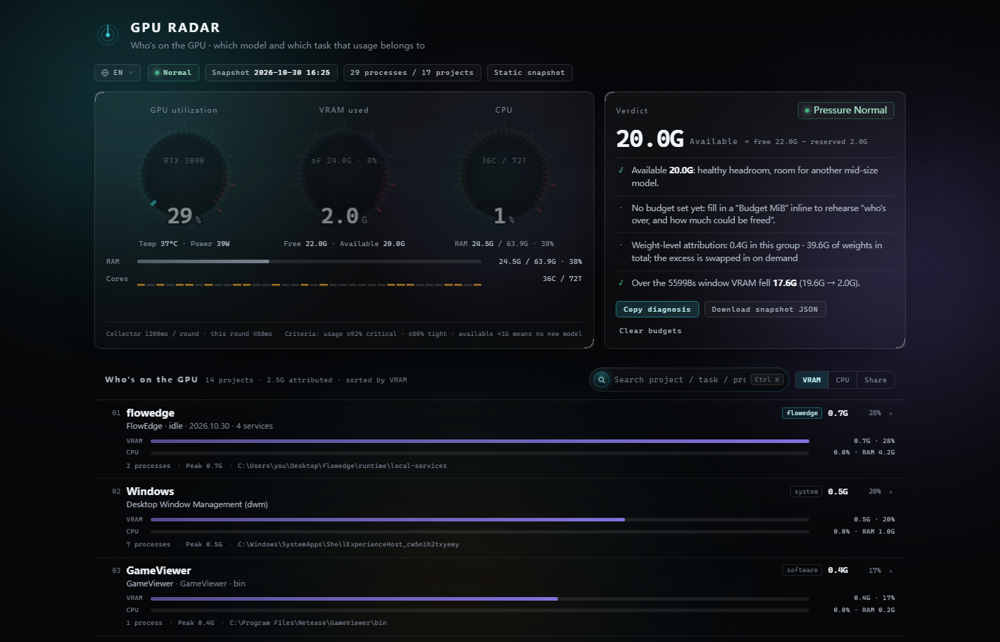

# GPU Radar — DSH plugin

A DSH plugin that answers one question: **who is using this machine's GPU, and which model or job owns that memory.**

A small badge sits to the left of the input box with live GPU / VRAM / CPU readings. Click it and a panel opens: VRAM is grouped by **project**, and each project drills down into its processes, the models it has loaded and the jobs it is running. From there you can pause, resume or kill processes, and pin a VRAM budget per project.



*Shot from the standalone web build of the same panel; as a plugin it renders as a popover next to the input box.*

## Features

- Three dials — GPU utilisation, VRAM in use, CPU utilisation — each with a 0–100% mini trend line underneath
- RAM bar plus one load column per core
- Project leaderboard sorted by VRAM; two bars per row (VRAM and CPU), sortable by CPU or RAM
- Project detail: member processes with VRAM / CPU / RAM / peak, a runtime overview, loaded models, running jobs
- Process control: pause, resume, kill — for one process or the whole project
- VRAM budgets: cap a project, over-budget rows go red; reserved headroom with a one-click suggested value
- Follows the host theme, light and dark
- Bilingual panel: English unless the active DSH locale is Chinese

## Install

Add one mount block to `~/.dsh/profiles/desktop/cordis.patch.yml`:

```yaml
- insert:
    - id: gpu-governor
      name: "file:///C:/Users/<you>/.dsh/plugins/dsh-gpu-governor/lib/index.js"
      config:
        intervalMs: 4000
```

Copy this repository to `~/.dsh/plugins/dsh-gpu-governor/` first. Editing `lib/client.js` only needs a page refresh; changing `lib/index.js` or `lib/*.ps1` needs a client restart.

## Use

The badge shows the busiest reading at a glance. The refresh button pulls a sample manually; the panel otherwise samples every 4 seconds. Kill requires a second click on the same button. `Esc` walks back out of the detail view.

| Question | Where the answer is |
|---|---|
| How much GPU / CPU / RAM is in use? | The three dials and the RAM bar |
| Who is holding VRAM? | Leaderboard rows are **projects**, not PIDs |
| Is it also burning CPU? | Two bars per row: VRAM and CPU |
| Which processes belong to this project? | Click a row: PID, VRAM, CPU, RAM, pause / kill |
| **Which model or job is it actually running?** | Detail view: runtime overview, loaded models, running jobs |
| How much can I still allocate? | Dial footnote: allocatable = free VRAM − reserved headroom |
| How did it get here? | The scope trace: last 10 minutes of VRAM (solid) and CPU (dashed) |

## Where the numbers come from

Under WDDM, per-process VRAM from `nvidia-smi` is always `[N/A]`, so per-process figures come from the driver performance counters instead.

| Metric | Source |
|---|---|
| Per-process VRAM | `Win32_PerfFormattedData_GPUPerformanceCounters_GPUProcessMemory` |
| Per-process GPU utilisation | The matching `...GPUEngine` class |
| Card-level VRAM, temperature, power | `nvidia-smi --query-gpu` |
| Per-process CPU and RAM | `Win32_Process`, delta of KernelModeTime and UserModeTime |
| Process product name | The exe's PE resource `FileDescription`, cached by path |
| Machine and per-core CPU | `Win32_PerfFormattedData_PerfOS_Processor` |
| RAM | `Win32_OperatingSystem` |

The collector is a resident PowerShell child process (`lib/collector.ps1`) that prints one JSON line per round. Fields the host does not recognise are ignored, so the two halves can be updated independently. One round takes a few hundred milliseconds to about a second, every 4 seconds by default.

## Project grouping

Command lines carry evidence of different strength, so they are bucketed first and the rules run in bucket order:

| Bucket | Example | Meaning |
|---|---|---|
| `script` | `D:\AI\ComfyUI\main.py`, `ArenaDemo.uproject` | What is running — the strongest evidence |
| `binary` | `...\Programs\Python311\python.exe` | The interpreter or program, i.e. only which software is in use |
| `arg` | `--user-data-dir=...\Roaming\@deepseek-ai` | A directory in the arguments — the weakest evidence |

Rule order: `workspace` → `desktop` → `path` (AI, Projects, UEProjects, models, …) → `software` → drive root → `exe` → `system`. So `python.exe D:\AI\ComfyUI-H3\main.py` becomes ComfyUI-H3, and `UnrealEditor-Cmd.exe ...\ArenaDemo.uproject` becomes ArenaDemo.

## Task identification

A `python.exe` says nothing on its own, so every process is turned into one sentence describing what it is doing:

| Situation | Shown as |
|---|---|
| `python.exe D:\AI\ComfyUI\main.py --port 8189`, queue holds `h3_t2v_fp8` | ComfyUI-H3 · h3_t2v_fp8.safetensors |
| `llama-server.exe --model ...\blobs\sha256-...`, Ollama holds `qwen2.5:14b` | Ollama · qwen2.5:14b |
| `FlowEdge.exe` with a running engine run | FlowEdge · text-to-video #338 |
| `DSH NEXT.exe --type=gpu-process` | DSH NEXT · GPU process |
| `UnrealEditor-Cmd.exe ArenaDemo.uproject -game` | UE · ArenaDemo |
| `tts_breeze_server.py` / `asr_server.py` | TTS · breeze / ASR · faster-whisper |
| `dwm.exe` / `csrss.exe` / `explorer.exe` | Desktop Window Manager (dwm) / session manager / Explorer |
| `node.exe server.mjs --port 3000` | node · server (second line: port=3000) |

Order: running FlowEdge run → resident LLM weights → ComfyUI weights → browser child role → local service script name → UE / Blender → system process role → interpreter plus script name → exe name plus install directory. When nothing can be probed it falls back to script name plus arguments, never a bare exe.

## Runtime overview

Numbers alone do not say what something is, so after each sample the host makes bounded local probes and attaches the result to the project. A closed port or a timeout only costs detail, never the resource numbers.

| Source | Endpoint | Gives |
|---|---|---|
| FlowEdge | `127.0.0.1:8080/api/health`, `/api/deps`, `/api/runs?status=running`, `/api/pipelines` | Engine version and uptime, dependency services, running runs |
| ComfyUI | Dependency endpoint plus `/queue`, `/system_stats`, `/history` | Queue, device VRAM, weights used by the last execution |
| Weight files | `<install>/models/**` and directories from `extra_model_paths.yaml` | On-disk size per weight file |
| Ollama | `127.0.0.1:11434/api/ps` | Resident model names, VRAM and size |

ComfyUI attribution stacks three layers of evidence: `ckpt_name`, `unet_name`, `vae_name` and `lora_name` from prompts in `/queue`; otherwise the latest entry of `/history`, ordered by the timestamps in `status.messages`, because ComfyUI does not unload weights on its own; sizes are stat'ed per model root and cached. When the weight total exceeds resident VRAM the panel says the remainder is swapped in on demand instead of inventing an active/resident split.

Bases can be overridden with `flowedgeBaseUrl`, `ollamaBaseUrl`, or the `FLOWEDGE_BASE_URL` and `OLLAMA_BASE_URL` environment variables. `probeServices: false` turns probing off entirely.

## Process control

| Action | Effect on VRAM | Effect on compute | Implementation |
|---|---|---|---|
| Pause | Not released, still held | Frozen | `NtSuspendProcess` |
| Resume | — | Unfrozen | `NtResumeProcess` |
| Kill | Released | Terminated | `taskkill /F /T`, children included |

Actions apply to one process or to a whole project, executed member by member with success and failure counts returned. Safety rules: only PIDs present in the current snapshot are accepted, PIDs at or below 8 are refused, DSH's own processes are refused, and every action appends one line to the audit trail. Pausing or killing other users' processes needs DSH running as administrator; otherwise the action reports access denied.

## VRAM budgets

Windows has no per-process VRAM quota, so this is a soft budget plus a balance view. Set `budgetMiB` on a project: the row turns red past it and the bar draws the budget tick. The header's "allocatable" is free VRAM minus the reserved headroom `reservedMiB`. The suggested reserve is 6% of the card, clamped to 512MiB–4G; a "use suggested" button appears when the current value differs by more than 256MiB. Snapshots also carry `pressure` (ok, warn, crit at 80% and 92%) and `overBudgetCount`, persisted in `state.json` across restarts. Nothing is blocked and nothing is killed automatically.

State lives in `~/.dsh/gpu-governor/state.json` (budgets and reserve); the audit trail is `~/.dsh/gpu-governor/audit.jsonl`, one line per control action, rotated past 512KB.

## Standalone web panel

`vram-radar-wb/` is the same idea as a dependency-free web page that runs without the DSH host — useful for screenshots, sharing a snapshot, or checking a machine where DSH is not installed. See [`vram-radar-wb/README.md`](vram-radar-wb/README.md).

## Layout

```
lib/index.js        host half: collector process, snapshot assembly, control actions, budgets, probes
lib/client.js       browser half: badge and React panel
lib/collector.ps1   resident sampler, one JSON line per round
lib/manage.ps1      suspend / resume helper
vram-radar-wb/      standalone web panel (engine + static page + optional skill)
```

## License

MIT
